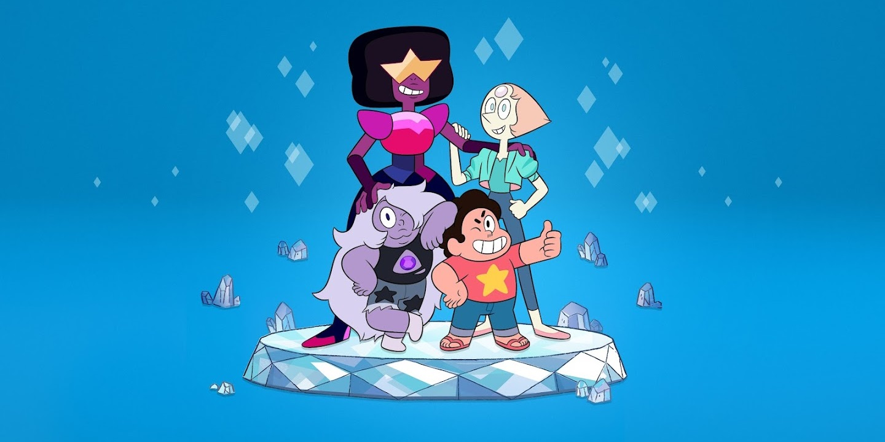

# Steven Universe Crystal Gems API
*You an visit the app live on the web, hosted at [**projects.nebuloid.dev/crystal-gem-api**](https://projects.nebuloid.dev/crystal-gem-api)!*

> Welcome to the Steven Universe Crystal Gems API!
> This project was made to showcase my proficiency with Mongoose, MongoDB, express, and handlebars.
> It was a part of a college course covering backend web philosophy and technology.
> While this app was made back in 2018, I updated it in 2026 so it would run smoothly once again.
> Give it a spin; I hope you enjoy it!

## What are Crystal Gems?
Gems are characters that, in the Steven Universe series, are powerful humanoids with a light-based body and a gemstone heart.
They have magic, super-hero powers, and can often conjure weapons from thin air.
In addition, two gems can fuse into a more powerful character or monster.

Some fans of the community like to create new gem characters, called *"gemsonas"*.
This API helps track the existing character cast, and create gemsonas.

## About the App
The app stores gems and fusions in MongoDB, including their names, weapons, powers, and relationships.
Browse and manage records through the web interface, or retrieve collection and detail data through JSON endpoints.
Forms support creating and editing gems and fusions, including user-created gemsonas.

## Routes
| Method     | Route                | Function                       |
| :--------- | :------------------- | :----------------------------- |
| `GET`      | `/`                  | Display the home page          |
| `GET`      | `/gem`               | List gems                      |
| `GET`      | `/gem/json`          | Return all gems as JSON        |
| `GET`      | `/gem/new`           | Display the new gem form       |
| `POST`     | `/gem`               | Create a gem                   |
| `GET`      | `/gem/:id`           | Display a gem                  |
| `GET`      | `/gem/:id/json`      | Return a gem as JSON           |
| `GET`      | `/gem/:id/edit`      | Display the gem edit form      |
| `PUT`      | `/gem/:id`           | Update a gem                   |
| `DELETE`   | `/gem/:id`           | Delete a gem                   |
| `GET`      | `/fusion`            | List fusions                   |
| `GET`      | `/fusion/json`       | Return all fusions as JSON     |
| `GET`      | `/fusion/new`        | Display the new fusion form    |
| `POST`     | `/fusion`            | Create a fusion                |
| `GET`      | `/fusion/:id`        | Display a fusion               |
| `GET`      | `/fusion/:id/json`   | Return a fusion as JSON        |
| `GET`      | `/fusion/:id/edit`   | Display the fusion edit form   |
| `PUT`      | `/fusion/:id`        | Update a fusion                |
| `DELETE`   | `/fusion/:id`        | Delete a fusion                |

## Development
### Project structure
- `source/config/`: environment configuration and Express setup
- `source/server/gem/` and `source/server/fusion/`: feature-specific controllers, models, and tests
- `source/server/utils/`: shared server utilities
- `source/public/`: static assets served by Express
- `source/views/`: Handlebars templates

### Local setup
Requirements: Node.js 26 or later, Yarn, and a MongoDB instance.
1. Install dependencies with `yarn install`.
1. Copy `.env.example` to `.env` and set `MONGODB_URI` to your MongoDB connection string. The example uses a local database. `PORT` is optional and defaults to `4040`.
1. Start the app with `yarn start`.
1. Open `http://localhost:4040/` (or use your configured port).

### Deployment
1. Deploy `render.yaml` on Render.
	Set `MONGODB_URI` to the Atlas connection string and allowlist Render's outbound IP ranges in Atlas Network Access.
1. Set `RENDER_ORIGIN` in `cloudflare/wrangler.toml` to your Render service URL.
	Add `CLOUDFLARE_API_TOKEN` and `CLOUDFLARE_ACCOUNT_ID` as GitHub repository secrets.
1. Ensure `projects.nebuloid.dev` has a proxied Cloudflare DNS record.
	Push the Cloudflare files to `main` to deploy the Worker; no Namecheap nameserver changes are needed.

Render's free service sleeps after 15 minutes without traffic and can take about a minute to wake.

## Future work
- Add automated tests and improve error handling
- Add c8 coverage reporting and Husky hooks
- Add user provisioning
